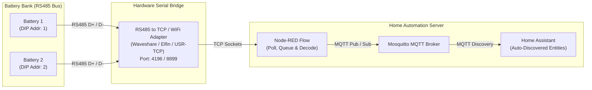

# Datou Boss 48V Battery (JBD UP16S BMS) Node-RED Flow for Home Assistant

[](https://nodered.org)
[](https://www.home-assistant.io)
[](PROTOCOL.md)
[](LICENSE)

A complete, production-ready **Node-RED flow** that bridges **Datou Boss 48V LiFePO4 home batteries** (equipped with the **JBD UP series / UP16S BMS**) to **Home Assistant** via MQTT Discovery.

---

## 🌟 Why This Flow Exists

Most open-source JBD BMS tools (such as Overkill Solar, BatMon, or ESPHome JBD integrations) are designed for the classic JBD UART protocol (`0xDD`/`0xA5`).

**Datou Boss DT-48314S, some Eco Worthy, and likely other batteries utilize the newer JBD UP series (UP16S) BMS**, which operates over an RS485 Modbus RTU-like variant with proprietary function codes (`0x78` read, `0x79` write). This flow implements full packet encoding, decoding, Modbus CRC-16 validation, rate-limited polling, and automatic Home Assistant MQTT discovery with **zero YAML configuration required**. The UP series BMS does respond to the 'classic' JBD protocol and provide voltage data etc, but some info is not returned properly such as cell balancing info. Hence this repo.

Multiple batteries can be addressed and queried from the master battery.

---

## 🏗️ System Architecture



---

## ⚡ Features

* **Zero-YAML MQTT Discovery:** Instantly populates Home Assistant with nicely grouped devices and entities.
* **Full 16-Cell Voltage Telemetry:**
  * Individual voltages for Cell 1 through Cell 16 ($mV$ resolution).
  * Cell Delta ($V_{max} - V_{min}$), Average, Median, Min/Max cell indices.
* **Pack Electricals:**
  * Real-time Voltage, Signed Current (positive = charging, negative = discharging), and Power (Watts).
  * State of Charge (SOC %), State of Health (SOH %), Remaining Ah, Full Capacity Ah, and Cycle Count.
* **Thermal Monitoring:**
  * Power MOSFET heatsink temperature.
  * Ambient internal enclosure temperature.
  * 4 individual cell probe temperatures.
* **Balancing Diagnostics:**
  * Live balancing state (ON/OFF).
  * Active balancing cell list (e.g. `1, 4, 12`).
  * Balance trigger voltage and delta threshold monitoring.
* **Comprehensive Protection & Alarms:**
  * Real-time binary sensor for active protection events and fault codes.
  * Cell and pack over/under-voltage thresholds, overcurrent cutoffs, and temperature alarm thresholds.
* **Inverter Demands & Dynamic Parameters:**
  * Charge demand voltage & current limits.
  * Discharge cutoff voltage & current limits.
* **Bidirectional BMS Control:**
  * Switch balance modes (`Static Balance` vs `Charge Balance`).
  * Adjust Charge Demand Voltage directly from Home Assistant.
* **Software Energy Metering:**
  * Coulomb counting calculating total energy input (kWh), energy output (kWh), and net Ah throughput.

---

## 🛠️ Hardware Requirements & Setup

### 1. Battery Hardware
* **Battery:** Datou Boss 48V (100Ah / 200Ah) with JBD UP series / UP16S BMS.
* **Addressing:** Set the front panel DIP switches:
  * **Battery 1:** Address `1` (DIP 1 ON, others OFF).
  * **Battery 2:** Address `2` (DIP 2 ON, others OFF).

### 2. RS485-to-Ethernet / WiFi Adapter
Connect an industrial serial gateway to the battery's RS485 port. Popular options include:
* **Waveshare RS485 to RJ45 Ethernet Converter** (e.g. RS485 TO ETH (B))
* **Elfin-EW11** (WiFi) or **Elfin-EE11** (Ethernet)
* **USR-TCP232-304 / 410s**

#### Serial Port Configuration on Bridge:
| Setting | Recommended Value |
| :--- | :--- |
| **Baud Rate** | `9600` (or `19200` depending on BMS firmware) |
| **Data Bits** | `8` |
| **Parity** | `None` |
| **Stop Bits** | `1` |
| **Flow Control** | `None` |
| **Protocol / Mode** | `TCP Server` or `TCP Client` |

---

## 🚀 Installation & Quick Start

### Step 1: Import the Flow into Node-RED
1. Download or copy the contents of [`flows/datou_boss_jbd_up16s.json`](flows/datou_boss_jbd_up16s.json).
2. Open Node-RED.
3. Click the menu icon (**☰**) in the top right corner $\rightarrow$ **Import**.
4. Paste the JSON and click **Import**.

### Step 2: Configure Your Network Nodes
Only two nodes need to be configured:

1. **Serial Bridge TCP Node:**
   * Locate the node named **`Connect to Serial Bridge (Configure IP & Port)`**.
   * Double-click it and update the **Host IP** and **Port** to match your RS485 gateway (e.g., `192.168.1.50`, port `4196`).
2. **MQTT Broker Node:**
   * Double-click any of the MQTT nodes (e.g. `mqtt out`).
   * Edit the broker configuration to point to your Home Assistant Mosquitto broker (or select your existing broker config if already set up in Node-RED).

### Step 3: Deploy & Run Discovery
1. Click **Deploy** in Node-RED.
2. In the flow tabs:
   * **Battery Modbus:** Handles automated polling (Main stats every 15s; protection/balance stats every 10 min).
   * **Battery 1 MQTT Discovery & Battery 2 MQTT Discovery:** Click the inject buttons once (or wait for the initial startup inject) to publish the discovery topics.
3. Open **Home Assistant** $\rightarrow$ **Settings** $\rightarrow$ **Devices & Services** $\rightarrow$ **MQTT**.
4. You will see **`battery_1`** and **`battery_2`** appear with all sensors and controls automatically populated.

---

## 🔧 Adapting for Single or Additional Batteries

### If You Only Have 1 Battery:
1. In the **Battery Modbus** tab, select and delete or disable the inject nodes labeled `(Batt 2)`.
2. Delete the **Battery 2 MQTT Discovery** tab.
3. Deploy changes.

### If You Have 3 or More Batteries:
1. Set the new battery DIP switch to the next address (e.g. Address `3` = `0x03`).
2. In **Battery Modbus**, duplicate the request nodes and change the address byte in the Buffer:
   ```javascript
   // Change 0x01 / 0x02 to 0x03
   msg.payload = Buffer.from([0x03, 0x78, 0x10, 0x00, 0x10, 0xA0, 0x00, 0x00, ...]);
   ```
3. Duplicate a Discovery tab, change `const bmsName = "battery_3";`, and inject.

---

## 📖 Protocol Specification

For full register maps, checksum calculation formulas, write authentication passwords, and raw hex examples, please see **[PROTOCOL.md](PROTOCOL.md)**.

---

## ❓ Troubleshooting

| Issue | Cause | Solution |
| :--- | :--- | :--- |
| **`CRC mismatch: Corrupted RS485 packet dropped`** | RS485 electrical noise or baud rate mismatch. | Verify baud rate (`9600`), verify termination resistor (120$\Omega$) on long runs, and swap RS485 A/B lines if inverted. |
| **TCP node shows `Disconnected` or `Timeout`** | Node-RED cannot reach the serial bridge. | Verify IP address, port, and subnet masks. Ensure no other application has locked the TCP socket. |
| **No entities appear in Home Assistant** | MQTT discovery not triggered or incorrect prefix. | Manually click the inject button on the **Battery 1 MQTT Discovery** tab. Confirm Home Assistant MQTT integration uses standard `homeassistant/` discovery prefix. |
| **Inverted current readings** | UP16S current offset. | UP16S current uses a 32-bit integer offset by 300,000. This is handled automatically by the parse node: `(rawCurrent - 300000) / 100`. |

---

## 📄 License

This project is licensed under the [MIT License](LICENSE). You are free to modify, distribute, and integrate this into your own home energy systems.
